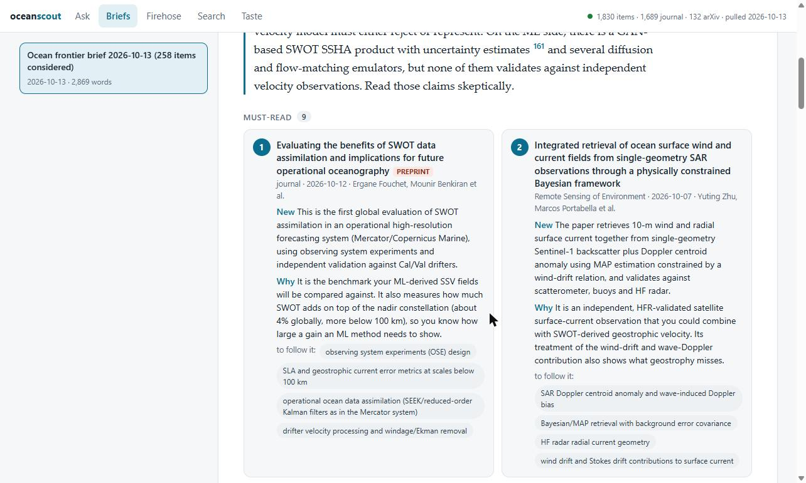
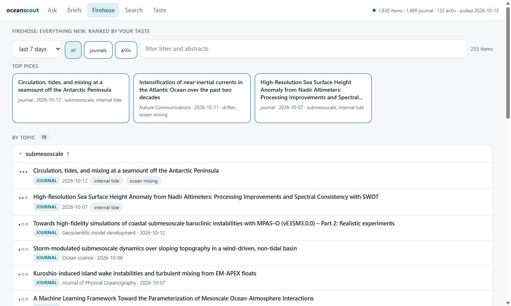

<h1 align="center">oceanscout</h1>

<p align="center">
  <b>A literature radar for physical oceanography.</b><br>
  Scans arXiv and every oceanography journal, ranks what's new against your taste,
  and writes briefs and literature syntheses using the Claude or Codex subscription you already pay for.
</p>

<p align="center">
  
  
  
  
</p>

<p align="center">
  
</p>

---

## Why

Keeping up with a research frontier means reading two hundred abstracts a week to find the five that
matter, then spending a day reconstructing where a sub-field stands before you can ask a good question.
oceanscout does the first part every Monday and the second part on demand:

- **Weekly brief.** What moved this week, the must-reads (what is new, why it matters, whether it is a
  preprint), the papers that touch *your* work specifically, the themes, and **what to study next** to
  be able to follow them.
- **Ask.** "SSV field inference from sparse coastal data" → a synthesis with where the field stands,
  the foundational papers, the frontier, key insights, open gaps you could fill, what to learn, and a
  reading order. Every claim cited and linked.
- **Firehose.** Everything new, grouped by the topics you track, relevance dots, one click to the DOI.

No API keys, no per-token bills. The model runs through the `claude` or `codex` CLI you are already
logged into. Everything else is free public APIs and the Python standard library.

## Install

Requirements: Python 3.9+ (with SQLite FTS5, which the python.org and conda builds include) and one of:

- [Claude Code](https://claude.com/claude-code) logged in to a Claude subscription (`claude` on your PATH), or
- [Codex CLI](https://github.com/openai/codex) logged in to ChatGPT (`codex` on your PATH).

```bash
git clone https://github.com/DALEE9000/oceanscout.git
cd oceanscout
python ocean.py pull --days 30     # backfill the local index (about a minute, no model call)
python gui.py                      # opens http://127.0.0.1:8765
```

That is the whole install. No `pip install`, no virtualenv, no `.env`.

To use Codex instead of Claude, set `OCEANSCOUT_LLM=codex`. To get into OpenAlex's faster "polite
pool", set `OCEANSCOUT_EMAIL=you@example.org`.

## Use

### GUI

<p align="center">
  
</p>

| Tab | What it does |
|---|---|
| **Ask** | Type a question, get a cited synthesis in a few minutes. Past answers stay in the sidebar, with a section jump-bar and superscript citations that link to the reference. |
| **Briefs** | Run or read weekly briefs. Must-reads, "for your work", study-next topics, themes. "Pull only" ingests without calling the model. |
| **Firehose** | Everything new, ranked and grouped by your Track terms. Click a row's metadata to expand the abstract. |
| **Search** | Full-text (BM25) search over the local index, filtered by source. |
| **Taste** | Edit `taste.md` in place. |

Long jobs run in the background with live progress in the bottom bar.

### CLI

```bash
python ocean.py digest            # pull new items, write digests/YYYY-MM-DD.md (+ .json)
python ocean.py digest --days 14  # wider window
python ocean.py ask "balanced/unbalanced separation in SWOT SSH near coasts"
python ocean.py search "HF radar SWOT validation"
python ocean.py pull              # ingest only
python test_ocean.py              # self-check
```

Answers land in `answers/`, briefs in `digests/`, as Markdown you can grep, commit, or paste.

## Taste

`taste.md` is the curation layer and the only thing you need to edit. The whole file goes to the
model with every brief and every answer, so write it like a note to a smart colleague: who you are,
what you work on, what counts as a must-read, what is noise. Two sections are also parsed:

```markdown
## Track
- SWOT altimetry          ← ranking boost; Firehose groups by these, in this order
- submesoscale
- HF radar

## Ignore
- coral                   ← dropped before the model ever sees them
- fisheries

## Notes
- ../my-literature-review ← directories of your own markdown, indexed as a source
```

## Sources

| Source | Via | Coverage |
|---|---|---|
| arXiv | Atom API | `physics.ao-ph`, plus ocean-keyword hits in `physics.flu-dyn`, `cs.LG`, `stat.ML`, `eess.SP`, `physics.geo-ph` |
| Journals | [OpenAlex](https://openalex.org) | The whole *Oceanography* subfield across all publishers, plus JPO, JTECH, JGR Oceans, GRL, JAMES, Ocean Modelling, Ocean Science, Prog. Oceanogr., RSE, J. Mar. Syst., AIES, DSR-I, Ocean Dynamics. Abstracts, DOIs, citation counts. Lags publication by days to a few weeks. |
| Your notes | files | any markdown directories listed under `## Notes` |

Edit `OA_SOURCES` and `ARXIV_Q` at the top of `ocean.py` to point it at a different field entirely;
nothing else is oceanography-specific.

## Schedule the weekly brief

**Windows** (Task Scheduler, Mondays 08:00):

```powershell
schtasks /create /tn OceanScout /sc weekly /d MON /st 08:00 /tr "cmd /c cd /d C:\path\to\oceanscout && python ocean.py digest > last_run.log 2>&1"
```

**macOS / Linux** (cron):

```cron
0 8 * * 1 cd /path/to/oceanscout && python ocean.py digest > last_run.log 2>&1
```

Pulls are resumable and overlap by three days, so a missed week is just a longer brief.

## How it works

```
 arXiv ─┐                        ┌─ digest ─ taste rank ─ model ─▶ digests/DATE.{md,json}
OpenAlex┼─ pull ─▶ ocean.db ─────┤
 notes ─┘      (SQLite + FTS5)   └─ ask ─ query planner ─ OpenAlex ×3 ─ FTS ─ model ─▶ answers/*.md
                                         (model)        cited │ recent │ relevant
```

- **Ranking without embeddings.** BM25 from SQLite's built-in FTS5 plus a few hundred abstracts in a
  strong model's context is enough at this scale. No vector database, no embedding bills.
- **Foundational vs. frontier.** `ask` first has the model rewrite your question into journal
  vocabulary, then queries OpenAlex three ways: top 40 by relevance, of which the most cited are
  foundational; the best matches are core; and a second pass limited to the last two years is the
  frontier. Your notes and local index are merged in.
- **Subscription, not API.** The model is called through `claude -p` (or `codex exec`) as a
  subprocess, so it bills your plan like an interactive session. `--setting-sources project` keeps your
  global Claude Code hooks and `CLAUDE.md` out of the output.
- **Local only.** The GUI is a stdlib `http.server` bound to `127.0.0.1`, with a custom-header check
  on every write so another tab cannot trigger a run, and DOMPurify on anything the model wrote.

## FAQ

**Does it cost anything?** No. arXiv and OpenAlex are free without keys; the model runs on your
existing subscription. Each `ask` is two model calls, each brief is one.

**Why no X / Twitter?** The API starts at about $100/month and scraping violates the terms. Bluesky
was tried and dropped: the signal-to-noise was not worth it.

**Can I point it at a different field?** Yes. Change the arXiv query and the OpenAlex subfield or
source list at the top of `ocean.py`, rewrite `taste.md`, and you have a radar for that field.

**Is the model output trustworthy?** It cites what it was given and is told to say when a well-known
paper was not retrieved. Treat it as a very good first pass, and click the DOIs.

## License

MIT
